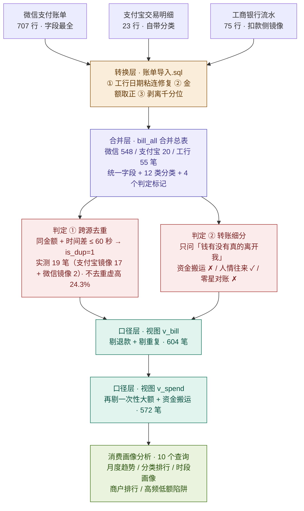

# 02_数据流图.md

> 作品集 #1 附加交付物 ｜ 可编辑源文件
> 可视版已在对话中渲染；下面 Mermaid 版本可直接粘进 Typora / Obsidian / GitHub 渲染。

## 数据流图（Mermaid）

## 如何读这张图

| 层 | 做什么 | 出错会怎样 |
|---|---|---|
| **原始层** | 三个外部系统各自导出，字段、时间格式、金额符号全不一致 | —— |
| **转换层** | 修数据质量缺陷（日期粘连、负号、千分位） | 日期错 → 去重失效、月度趋势错位 |
| **合并层** | 统一字段 + 分类 + 打判定标记 | 分类不互斥 → 占比加不到 100% |
| **判定层** | 两个业务判断（去重、转账性质） | **判断错 → 结论方向全错，SQL 写得再漂亮也没用** |
| **口径层** | 把口径固化成视图，全局唯一来源 | 口径散落 → 改一处漏十处 |
| **分析层** | 出 10 个业务查询 | 分子分母口径不一致 → 占比系统性偏小 |

## 设计要点

1. **判定层被单独画出，不混进转换层**。清洗是机械劳动，判定是业务能力 —— 图的结构本身就要体现「价值在哪」。
2. **口径层收成视图**，而不是散在每个查询的 `WHERE` 里。这是需求规格里最硬的一条约束。
3. **三源并行汇入转换层**，明确表达「三份数据、一套口径」的合并语义。
