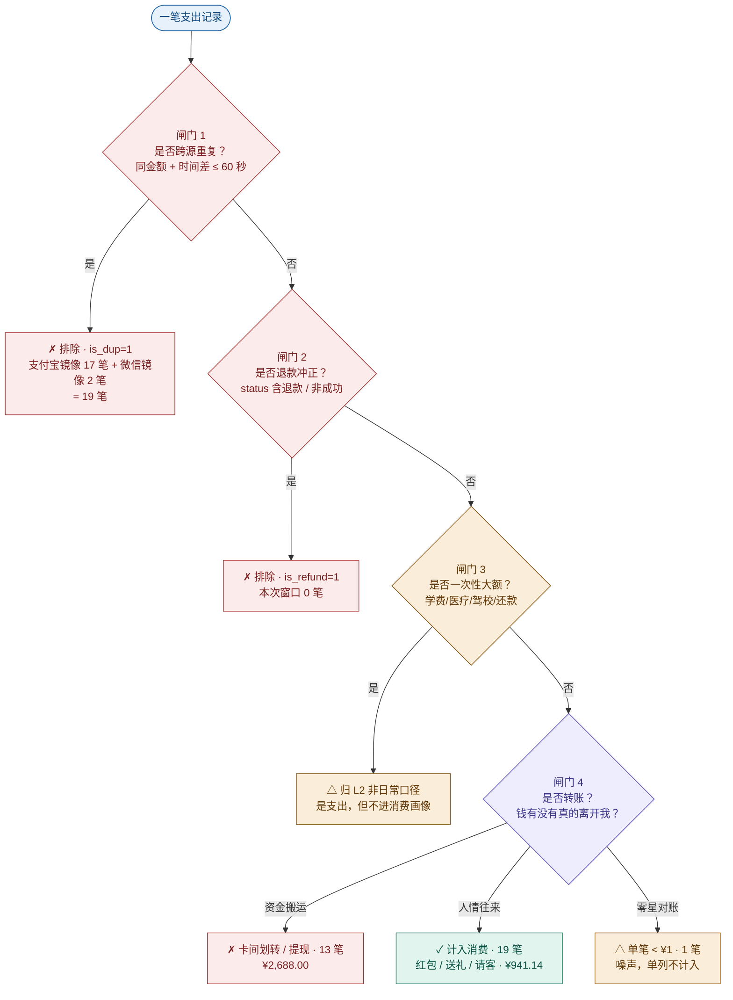

# 03_消费判定决策树.md

> 作品集 #1 附加交付物 ｜ 可编辑源文件
> 可视版已在对话中渲染；下面 Mermaid 版本可直接粘进 Typora / Obsidian / GitHub 渲染。

## 消费判定决策树（Mermaid）

## 四道闸门速查表

| 闸门 | 判定问题 | 判为「是」的处理 | 实测命中 | 依据来源 |
|---|---|---|---|---|
| 1 | 同金额 + 时间差 ≤ 60 秒？ | 排除（`is_dup=1`） | 19 笔 | **支付宝镜像 17 笔（主力）+ 微信镜像 2 笔**；判据已从「完全相等」修订为 60 秒容差，原因见下方专节 |
| 2 | 状态含「退款」或非交易成功？ | 排除（`is_refund=1`） | 0 笔 | 微信原始「支出」标记含退款冲正 |
| 3 | 学费 / 医疗 / 驾校 / 还款？ | 归 L2 非日常口径 | 53 笔 | ¥3,000 学费与 ¥12 奶茶混算会带偏均值 |
| 4 | 转账的钱有没有真的离开我？ | 分类处理（见下） | 33 笔 | 转账下混着三种性质完全不同的钱 |

### 闸门 1 的判据修订：一次实测发现的漏判（v1 → v2）

| 版本 | 判据 | 命中 | 问题 |
|---|---|---|---|
| v1 | 时间**完全相等** + 金额相等 | 5 笔 | **漏判 14 笔** |
| v2（现行） | 同金额 + **时间差 ≤ 60 秒** | 19 笔 | 仍剩 1 笔在容差外；且放宽后误伤风险上升 |

**发现过程**：用「时间差 ≤ 60 秒」做压力测试，发现支付宝走工行卡共 18 笔，v1 只抓到 4 笔。

| 秒差 | 笔数 | v1 能否抓到 | 实例 |
|---|---|---|---|
| 0 秒 | 4 | ✅ | 抖音生活服务商家 17:43:45 |
| 1–2 秒 | 4 | ❌ | 哈啰出行 +2 秒 |
| 6–16 秒 | 10 | ❌ | U净洗烘 **+16 秒** |

**根因**：第三方渠道**落账延迟**。同一笔交易在不同系统的记账时刻天然有差异，0~16 秒属正常。

**这不是技术 bug，是需求定义错误**：v1 把「时间相等」当业务规则执行，但业务事实是「同一笔交易在不同渠道的落账时间**允许有延迟**」。
**写代码之前，没人问过「延迟允许多少」** —— 这才是真正的失误。

**v2 的残余风险（必须承认）**：60 秒是按实测最大延迟 16 秒留的安全边界，**是我单方面设定的，不是业务裁决**。
容差取多少、误判由谁承担 —— 属于必须由业务方拍板的权衡。

### 闸门 1 的反例：有一种记录「长得像重复，但绝不能剔」

微信「**零钱提现**」12 笔 / 工行「**微信零钱提现**」11 笔 —— 两边都有，看起来就是教科书式的重复记账。

**但它不是。三条理由：**

1. 微信侧该记录 `in_out = "/"`，**从来没进过支出统计**
2. 工行侧金额是**正数**（余额 ¥0.72 → ¥200.72），是**入账**
3. 两边金额**根本对不上**：微信记 ¥200.20、工行记 ¥200.00，差的是 **0.1% 提现手续费**

**正确归类是「资金搬运」**（钱从微信零钱挪到银行卡），不是「重复」。**判断依据不是"两边都有"，而是"这笔钱是不是同一笔支出被算了两次"。**

> 这条反例的价值：说明闸门 1 的判据必须是**语义判据**（是否重复支出），不能是**形态判据**（是否两边都有记录）。
> 只看形态，就会把一笔本来就没算进支出的记录再剔一次 —— 凭空制造误差。

### 闸门 1 的边界：39 笔工行消费里 22 笔找不到来源

工行「消费 快捷支付」共 **39 笔**，只有 **17 笔**能在支付宝找到镜像、**0 笔**在微信找到。
剩下 **22 笔**（小额居多）把容差放宽到 **1 天**也新增 0 笔匹配。

→ 说明它们**不是「漏判」，是「没有对应的源可以匹配」**：要么是直接在别的 App 里绑卡付的，要么是支付宝账单导出不全（6 个月仅 23 笔）。
→ **闸门 1 的能力上限由数据完整性决定，不由阈值决定。**

**2026-10-12 实证（两年期数据，工行 PDF 新增「对方户名」列）**：这 22 笔的来源查清了 ——
**拼多多系合计 91 笔 ¥1,412.40，占工行 206 笔消费的 44%（金额 38%）**；抖音仅 3 笔 ¥11.57。

> **⚠ 本文 v1.2 曾写「可能是抖音等 App 内消费」。这是无证据时的印象归因，实测错了，量级差 30 倍。**
> 教训：**数据里没有的列，就不要在文档里写出具体结论。** 正确写法是「来源未知，待补含对方户名的凭证」。

### 闸门 4 的三种去向

| 去向 | 定义 | 处理 | 笔数 | 金额 |
|---|---|---|---|---|
| **资金搬运** | 卡间划转 / 提现 / 零钱提现转银行卡 | ✗ 不计入消费 | 13 | ¥2,688.00 |
| **人情往来** | 红包 / 送礼 / 请客 / 垫款 | ✓ **计入消费** | 19 | ¥941.14 |
| **零星对账** | 单笔 < ¥1（如 ¥0.10 附言对账） | △ 噪声，单列 | 1 | ¥0.10 |

## 两条被推翻的旧规则（保留警示）

| 版本 | 规则 | 为什么错 |
|---|---|---|
| v1 | 用「金额有无角以下零头」判 AA 分账 | 只捞到 ¥6.74 一笔。6.50 / 22.50 / 104.50 乘 10 都是整数，全被漏掉 |
| v2 | 用「金额是否整元」判 AA + 整体剔除人情往来 | ① 同一人 12 笔里 5 笔整元，与带零头记录无本质区别，自相矛盾；② 抹掉 ¥941.14 真实开销，把「消费」与「支出」混为一谈 |
| **v3（现行）** | 不猜性质，只问「钱有没有真的离开我」 | 数据无可靠特征区分 AA 与送礼 → 诚实归一类 + 写进局限，**不伪造精度** |

---

## 从 1 人到 100 人：四层设计的失效顺序

> 单人 604 笔的数据量掩盖了很多约束。这份分析回答的是「这套设计在什么条件下会先撑不住」。
> **判断力的标志 = 能说出「我的方案在什么条件下会失效」，而不是「我的方案很好」。**

| 顺序 | 崩的东西 | 前提假设 | 放大后发生什么 | 修复代价 |
|---|---|---|---|---|
| **0** | **数据可见性** | 「我手里的账单 = 我全部的支付行为」 | **已经崩了**：工行 39 笔快捷支付消费 **22 笔找不到任何来源**（2026-10-12 实证主因：拼多多系，无导出入口）。且**「没发生」与「没拿到」在数据里长得一样** | 极高：不是技术问题，是**渠道数据获取权限**问题 |
| **1** | 跨源去重 | 「金额+时间」足以判定同一笔 | **已经崩了**：漏判 14 笔；**两年期回验：60 秒仅覆盖 92%，需 300 秒才 100%**。放量后同秒同额碰撞叠加，**且是静默错、不报错** | 高：需订单号映射表或人工确认队列 |
| 2 | 分类关键词 | 商户名含「餐/饭/奶茶」即为餐饮 | 出现未见过的商户（如「一碗情深」），全落进「其他消费」，占比从 17.7% 膨胀到 40%+ | 中：需维护词库或引入模型 |
| 3 | 转账性质判定 | 工行「转账」= 搬运；微信/支付宝 = 人情 | 别人的转账里混着代付房租、拼单、还花呗，规则失效 | 中：需按用户配置规则 |
| 4 | 手工导入流程 | 文件放目录、人工双击跑 SQL | 100 人 300 份文件，格式各异、需权限隔离 | 高：**已不是分析问题，是产品化问题** |

**统一根因**：所有规则都是从这 604 笔里**反推**出来的 —— 本质是拟合了一个样本。
不是模型过拟合，而是**规则过拟合**。样本一换，规则成片失效。

**但比「规则不准」更早崩的是「数据可见性」**：
闸门 1 的能力上限**不是阈值取多少，而是有没有对应的源可以匹配**。
22 笔工行消费把容差放宽到 **1 天**也新增 0 笔匹配 —— 它们**不存在于任何可导出的账单里**（App 内消费，平台不提供导出；两年期实证主因为拼多多系）。

更麻烦的是**「没发生」和「没拿到」在数据里长得一模一样**：
- 支付宝 2026-08 是 **0 笔** —— 但这是「没用」，**不是「缺了」**（当月微信 87 笔、工行 3 笔）
- 工行 22 笔无源 —— 这是**真缺失**
- **两者在表里都是「无匹配」，SQL 分辨不了**

→ **这不是"我算错了"，是"我拿不到"。** 分析工作的第一个瓶颈永远在数据可见性，不在算法。
→ 要分辨，必须引入**数据之外的知识**（业务方回忆 / 渠道可用性登记），**这是需求规格的活，不是 SQL 的活**。

**最危险的特征**：第 0 位到第 2 位的失效都是**静默的**。
程序不报错、查询照常返回结果、报告照常生成 —— 只是数字是错的。
**这比程序崩溃危险得多，也是「跑通了」和「跑对了」的区别。**
